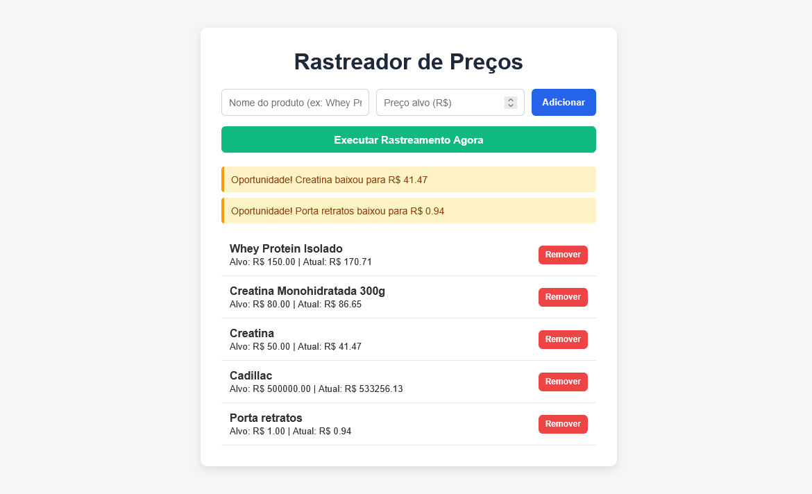

# 🛒 Price Tracker Automation

Sistema Full-Stack para monitoramento automático de preços, focado em automação, manipulação de dados e integração de APIs. Este projeto marca a consolidação de conceitos fundamentais de programação e arquitetura de software.

## 🌐 Demonstração ao Vivo (Deploy)

- **Aplicação Web (Front-end na Vercel):** [Acessar Rastreador de Preços](https://price-tracker-automation-frontend.vercel.app)
- **API REST & Documentação Swagger (Back-end no Render):** [Acessar API](https://price-tracker-automation-qg51.onrender.com/docs)

> *Nota sobre hospedagem gratuita: A API está hospedada no plano gratuito do Render e entra em modo de hibernação após 15 minutos de inatividade. Caso seja o primeiro acesso, aguarde cerca de 30 segundos para o servidor inicializar.*



## ⚠️ Nota sobre o Processo de Estudo
Este projeto foi desenvolvido estritamente para fins de **estudo e prática**. Para garantir a construção de memória muscular e a compreensão profunda de cada comando, **100% do código foi digitado manualmente, linha por linha**, sem o uso de cópia e cola de blocos prontos. Cada função, rota e regra de CSS foi analisada e implementada manualmente.

---

## 🚀 O Projeto

O **Price Tracker Automation** simula um robô de rastreamento de preços de e-commerce. O usuário cadastra produtos desejados com um "preço alvo", e o sistema varre (simulação via Back-end) os preços atuais do mercado, gerando alertas visuais automáticos sempre que uma oportunidade de compra (preço atual menor ou igual ao preço alvo) é encontrada.

### ✨ Funcionalidades
- **Cadastro Dinâmico:** Adição de novos produtos para monitoramento em tempo real.
- **Leitura (GET):** Listagem de todos os produtos cadastrados buscando dados direto da API.
- **Rastreamento Automatizado:** Motor de simulação de preços (usando variação matemática) que avalia se os alvos foram atingidos.
- **Alertas Inteligentes:** Notificações visuais no Front-end indicando exatamente quais produtos atingiram o valor desejado.
- **Exclusão (DELETE):** Remoção de produtos da base de monitoramento.

---

## 🛠️ Tecnologias e Arquitetura

O projeto foi dividido em duas camadas independentes (Back-end e Front-end), comunicando-se via requisições HTTP (REST):

### Back-end (Motor e API)
- **Python 3:** Linguagem principal do servidor.
- **FastAPI:** Framework web moderno e de alta performance para construção da API.
- **Uvicorn:** Servidor ASGI para rodar a aplicação.
- **Pydantic:** Tipagem estática e validação de dados (garantindo que strings e floats sejam respeitados nas requisições).
- **CORS Middleware:** Configuração de segurança para permitir o consumo da API pelo Front-end.

### Front-end (Interface Visual)
- **HTML5:** Estrutura semântica.
- **CSS3 (Flexbox):** Estilização responsiva, limpa e moderna (sem uso de frameworks como Bootstrap, tudo feito do zero).
- **JavaScript (Vanilla):** Lógica de tela, manipulação do DOM e consumo da API utilizando `Fetch API` e funções assíncronas (`async/await`).

---

## 🧠 Conceitos de Programação Aplicados

Durante a construção deste projeto, os seguintes fundamentos (baseados na trilha de Python) foram aplicados em um cenário real:
1. **Tipos de Dados:** Uso rigoroso de `str`, `float` e `int`.
2. **Controle de Fluxo e Loops:** Uso de `for` e `if/else` no motor de rastreamento para avaliar as condições de preço.
3. **Listas e Dicionários:** Criação de um banco de dados em memória utilizando uma lista de dicionários.
4. **Funções:** Encapsulamento de lógicas em rotas específicas (`def` no Python, `function` no JS).
5. **Módulos:** Importação de bibliotecas nativas (`random`) e externas (`fastapi`).
6. **Programação Orientada a Objetos:** Criação de esquemas de validação (`class ProdutoCreate(BaseModel)`).

---

## ⚙️ Como Executar o Projeto Localmente

Para rodar este projeto na sua máquina, siga os passos abaixo:

### 1. Preparando o Back-end
Abra o terminal na pasta raiz do projeto e execute:

```bash
# Crie o ambiente virtual
python -m venv venv

# Ative o ambiente virtual
# No Windows:
.\venv\Scripts\activate
# No Mac/Linux:
source venv/bin/activate

# Instale as dependências
pip install -r requirements.txt

# Inicie o servidor local
uvicorn backend.main:app --reload
```

A API estará rodando em `http://127.0.0.1:8000`. Você pode acessar a documentação interativa automática do Swagger UI em `http://127.0.0.1:8000/docs`.

### 2. Rodando o Front-end
Com o servidor Python rodando no terminal, abra o arquivo `frontend/index.html` no seu navegador.
- *Dica:* Se estiver usando o VS Code, utilize a extensão **Live Server** para abrir a página.

---
*Desenvolvido com foco e disciplina como parte da construção de portfólio.*